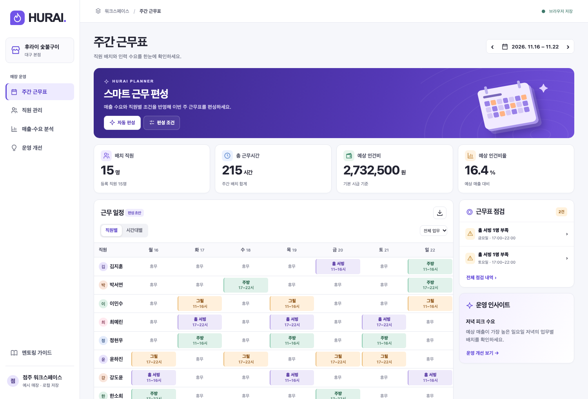

# HURAI · 후라이

교대근무 직원이 10명 이상인 독립 고깃집을 위한 주간 근무표 편성 웹앱입니다. 점주는 홀 서빙·주방·그릴에 필요한 인원을 확인하고, 직원의 업무 역량과 근무 가능 시간을 반영한 배치안을 수정·확정할 수 있습니다.

**[로그인 없이 데모 열기](https://aikian.github.io/hurai/)**



## 첫 근무표 확정하기

처음 방문하면 가상 직원 15명의 **2026년 11월 16일~22일** 근무표가 열립니다. 금요일과 토요일 저녁에 홀 직원이 한 명씩 빠진 시연용 초안입니다.

1. **근무표 점검**에서 부족 항목을 선택하면 해당 교대를 맡을 수 있는 직원과 시급을 확인할 수 있습니다.
2. **자동 편성**을 누르면 기존 일정과 달라지는 칸 수와 남은 점검 항목이 표시됩니다. 기본 예시에서 **편성안 적용**을 누르면 부족 항목이 2건에서 0건으로 줄어듭니다.
3. **근무표 확정**으로 편집을 잠급니다. 변경이 필요하면 **편집 재개**를 선택하세요. 근무 일정 오른쪽 위 다운로드 버튼으로 해당 주의 일정을 CSV로 저장할 수 있습니다.

## 편성 방식

| 단계 | 계산과 판단 기준 |
| --- | --- |
| 수요 산정 | 요일별 점심·저녁 평균 매출을 홀 46%, 주방 29%, 그릴 25%로 나눕니다. 업무별 금액을 직원 1명당 기준 매출(기본 60만 원)로 나눠 올림하고, 업무마다 최소 1명을 둡니다. 이 비중과 기준액은 시연용 가정입니다. |
| 후보 선별 | 업무 자격, 희망 휴무일, 가능 시간대, 주간 근무시간 상한을 확인합니다. 한 직원은 하루 최대 한 교대에 배정됩니다. 점심은 11~16시, 저녁은 17~22시입니다. |
| 배치안 선택 | 요일과 업무를 순회하는 순서를 바꿔 24개 배치안을 만듭니다. 채우지 못한 구간에 큰 벌점을 주고, 근무시간 분산·선호 교대·시급 등을 반영한 점수가 가장 낮은 안을 제시합니다. |
| 점검과 확정 | 수동 수정 때도 인력 부족과 개인별 조건 위반을 다시 계산합니다. 점검 항목이 남으면 확정 단계에서 수정할 내역을 보여줍니다. |
| 다음 주 개선 | 저녁 매출과 해당 요일의 혼잡 피드백 건수로 홀 보강 후보를 선정합니다. 관리자가 승인하면 다음 주 해당 교대의 필요 인원이 1명 늘어납니다. |

현재 버전은 브라우저에서 실행되는 휴리스틱과 규칙 기반 제안을 사용합니다. OR-Tools 도입과 생성형 AI를 활용한 피드백 본문 분석은 멘토링 가이드에서 다루는 후속 설계입니다. 예상 인건비는 배치 시간에 기본 시급을 곱한 금액이며, 급여 정산과 법정 근로 규정 전체의 검증은 구현 범위에서 제외합니다.

## 로컬 실행

Python 3이 설치된 환경에서 다음 명령을 실행합니다. 패키지 설치나 빌드 단계는 없습니다.

```bash
git clone https://github.com/aikian/hurai.git
cd hurai
python3 -m http.server 8000 --bind 127.0.0.1
```

브라우저에서 [로컬 웹앱](http://127.0.0.1:8000/)을 엽니다. 직원 조건, 주차별 편성안, 피드백, 개선안 승인 상태는 해당 브라우저의 `localStorage`에 저장됩니다. 다른 기기나 다른 접속 주소와 데이터가 동기화되지 않습니다. 기존 작업을 보존하면서 초기 예시를 다시 보려면 새 시크릿 창에서 데모를 여세요.

## 코드 구조

| 파일 | 역할 |
| --- | --- |
| [index.html](index.html) | 페이지 진입점. 편성 엔진과 화면 스크립트를 순서대로 로드합니다. |
| [engine.js](engine.js) | 초기 데이터, 수요 산정(`need`), 자동 배치(`generate`), 조건 점검(`rules`, `issues`)을 담당합니다. |
| [app.js](app.js) | 해시 기반 화면 이동, 근무표 편집·확정, 직원 조건 관리, 매출 입력, 피드백 승인, CSV 내보내기와 로컬 저장을 처리합니다. |
| [style.css](style.css) | 데스크톱·모바일 레이아웃, 업무별 근무 칸, 점검 패널과 대화상자를 정의합니다. |

## 배포와 변경 확인

GitHub Pages가 `main` 브랜치의 루트(`/`)를 게시합니다. 변경한 정적 파일을 `main`에 푸시하면 같은 데모 주소에 반영됩니다.

편성 로직을 수정한 뒤에는 새 시크릿 창에서 위의 **첫 근무표 확정하기** 절차를 재현하세요. 수동 편집도 확인하려면 확정된 주의 편집을 재개하고, 직원 한 명을 희망 휴무일에 배치하세요. 점검 내역에 해당 직원이 표시되고, 새로고침 후에도 수정한 일정이 유지되어야 합니다.
